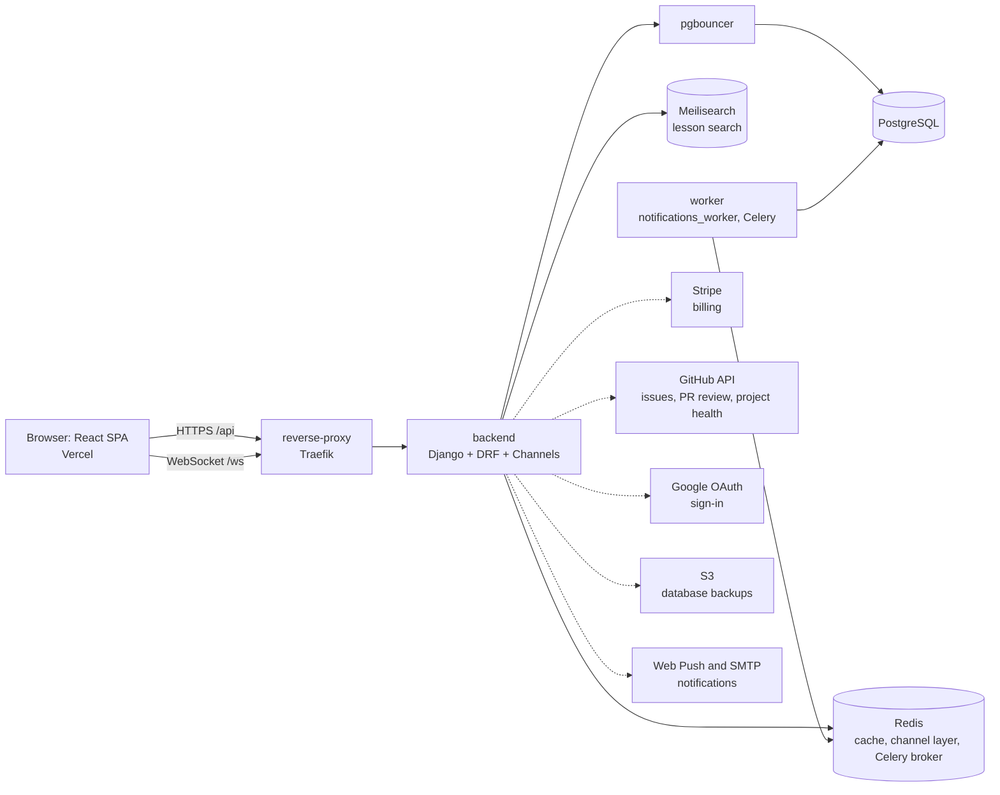
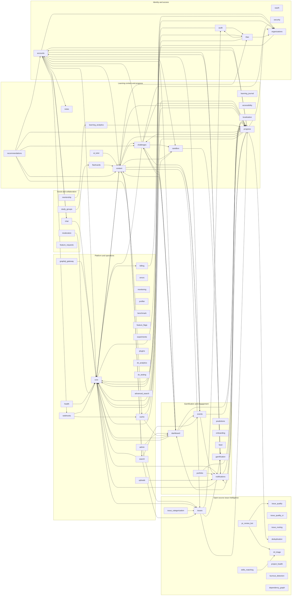

# Architecture Overview

How the pieces of Contribution Atelier fit together: the services that run, the 62 backend apps and how they depend on each other, and which apps talk to external services. The WebSocket details are at the end.

## Runtime

Services in `docker-compose.yml`: `reverse-proxy`, `db`, `redis`, `meilisearch`, `pgbouncer`, `backend`, `worker`, `frontend`. Dashed arrows are optional integrations that are only used when their credentials are configured.

## Backend apps by domain

`backend/apps/` has 62 directories. 56 are Django apps in `INSTALLED_APPS`; `health`, `graphql_gateway`, `benchmark` and `profiler` are not installed apps (the first two are only routed, the last two are tooling), and `admin` is a helper module. `migrations` holds data-migration tooling and is not an app. Apps are grouped into six domains:

| Domain | What it is for |
| --- | --- |
| Identity and access | Accounts, social sign-in, roles and permissions, organizations (tenants), the audit trail |
| Learning content and progress | Lessons and curriculum, progress tracking, challenges and the code sandbox, flashcards, notes, journals, analytics, AI tutor, accessibility, localization, recommendations |
| Gamification and engagement | XP and badges, dashboard, notifications, events, predictions, onboarding, portfolio, activity feed |
| Social and collaboration | Chat and pair programming, mentorship, study groups, moderation, feature requests |
| Open-source issue intelligence | Issue ingestion, quality scoring, categorisation, routing, duplicate detection, PR review bot, skills matching, project health, burnout detection, dependency graph |
| Platform and operations | `core` shared code, cache, errors, monitoring, health, profiling, feature flags, experiments, webhooks, uploads, plugins, billing, search, GraphQL gateway, developer-experience tooling |

## Dependency graph and tiers

An arrow `A --> B` means app A imports from app B. The graph, table and tiers below are **generated** from the code by `scripts/app_dependency_graph.py`; do not edit between the markers. After adding an app or an import between apps run `python scripts/app_dependency_graph.py --write` (add a new app to `DOMAINS` in that script first).

**Tiers** are by how many other apps import an app:

- **Core**: imported by 3 or more apps. Changing these affects much of the backend: be careful, add tests, avoid breaking their public functions and models.
- **Supporting**: imported by 1 or 2 apps.
- **Optional**: imported by no other app. These are leaf features; one can be removed from `INSTALLED_APPS` and `config/urls.py` without a broken import (check its Celery tasks and signals first).

<!-- app-graph:start -->

| App | Domain | Tier | Imports | Imported by | Installed | External services |
| --- | --- | --- | --- | --- | --- | --- |
| `accessibility` | Learning content and progress | Optional | - | - | yes | - |
| `accounts` | Identity and access | Core | `chat`, `content`, `core`, `dashboard`, `events`, `notes`, `notifications`, `organizations`, `progress`, `sandbox`, `webhooks` | `challenges`, `chat`, `notifications`, `progress`, `recommendations` | yes | Email (SMTP), GitHub API, Google OAuth, Redis, WebSockets (Channels) |
| `admin` | Platform and operations | Optional | `dashboard`, `issues` | - | no | - |
| `advanced_search` | Platform and operations | Optional | - | - | yes | LLM API |
| `ai_tutor` | Learning content and progress | Optional | `content` | - | yes | LLM API |
| `audit` | Identity and access | Supporting | `core`, `rbac` | `issues`, `rbac` | yes | Celery |
| `benchmark` | Platform and operations | Optional | - | - | no | WebSockets (Channels) |
| `billing` | Platform and operations | Supporting | `organizations` | `core` | yes | Stripe |
| `burnout_detection` | Open-source issue intelligence | Optional | - | - | yes | Celery, GitHub API |
| `cache` | Platform and operations | Supporting | `dashboard`, `progress` | `recommendations`, `webhooks` | yes | - |
| `challenges` | Learning content and progress | Core | `accounts`, `core`, `dashboard`, `events`, `organizations`, `progress`, `sandbox` | `content`, `dashboard`, `progress`, `recommendations` | yes | - |
| `chat` | Social and collaboration | Supporting | `accounts`, `core` | `accounts` | yes | WebSockets (Channels) |
| `content` | Learning content and progress | Core | `challenges`, `core`, `events`, `issues`, `progress`, `rbac`, `sandbox`, `search` | `accounts`, `ai_tutor`, `core`, `dashboard`, `flashcards`, `progress`, `recommendations`, `search` | yes | Embeddings model, WebSockets (Channels) |
| `core` | Platform and operations | Core | `billing`, `content`, `dashboard`, `issues`, `notifications`, `organizations`, `progress`, `rbac` | `accounts`, `audit`, `challenges`, `chat`, `content`, `dashboard`, `graphql_gateway`, `health`, `moderation`, `notifications`, `organizations`, `progress`, `rbac`, `sandbox`, `search`, `webhooks` | yes | Celery, Email (SMTP), GitHub API, Redis, WebSockets (Channels) |
| `dashboard` | Gamification and engagement | Core | `challenges`, `content`, `core`, `events`, `progress` | `accounts`, `admin`, `cache`, `challenges`, `core`, `progress` | yes | WebSockets (Channels) |
| `deduplication` | Open-source issue intelligence | Supporting | - | `progress` | yes | - |
| `dependency_graph` | Open-source issue intelligence | Optional | - | - | yes | - |
| `dx_analytics` | Platform and operations | Optional | - | - | yes | Celery |
| `dx_testing` | Platform and operations | Optional | - | - | yes | - |
| `errors` | Platform and operations | Optional | - | - | yes | Celery |
| `events` | Gamification and engagement | Core | `notifications`, `progress` | `accounts`, `challenges`, `content`, `dashboard`, `search` | yes | - |
| `experiments` | Platform and operations | Optional | - | - | yes | - |
| `feature_flags` | Platform and operations | Optional | - | - | yes | - |
| `feature_requests` | Social and collaboration | Optional | - | - | yes | WebSockets (Channels) |
| `feed` | Gamification and engagement | Optional | - | - | yes | WebSockets (Channels) |
| `flashcards` | Learning content and progress | Supporting | `content` | `study_groups` | yes | - |
| `gamification` | Gamification and engagement | Supporting | `progress` | `issues`, `sandbox` | yes | - |
| `graphql_gateway` | Platform and operations | Optional | `core` | - | no | - |
| `health` | Platform and operations | Optional | `core` | - | no | Meilisearch, Redis, WebSockets (Channels) |
| `issue_categorization` | Open-source issue intelligence | Optional | `issues` | - | yes | - |
| `issue_quality` | Open-source issue intelligence | Supporting | - | `pr_review_bot` | yes | Celery |
| `issue_quality_ci` | Open-source issue intelligence | Optional | - | - | yes | - |
| `issue_routing` | Open-source issue intelligence | Optional | - | - | yes | - |
| `issues` | Open-source issue intelligence | Core | `audit`, `gamification`, `progress` | `admin`, `content`, `core`, `issue_categorization`, `search` | yes | - |
| `learning_analytics` | Learning content and progress | Supporting | `progress` | `mentorship` | yes | - |
| `learning_journal` | Learning content and progress | Optional | - | - | yes | - |
| `localization` | Learning content and progress | Optional | - | - | yes | - |
| `mentorship` | Social and collaboration | Optional | `learning_analytics` | - | yes | - |
| `ml_triage` | Open-source issue intelligence | Supporting | - | `pr_review_bot`, `skills_matching` | yes | GitHub API |
| `moderation` | Social and collaboration | Optional | `core` | - | yes | - |
| `monitoring` | Platform and operations | Optional | - | - | yes | Celery, Redis, S3 (boto3), WebSockets (Channels) |
| `notes` | Learning content and progress | Supporting | - | `accounts` | yes | WebSockets (Channels) |
| `notifications` | Gamification and engagement | Core | `accounts`, `core`, `progress` | `accounts`, `core`, `events`, `portfolio`, `progress`, `uploads` | yes | Celery, Email (SMTP), Web Push, WebSockets (Channels) |
| `oauth` | Identity and access | Optional | - | - | yes | - |
| `onboarding` | Gamification and engagement | Optional | - | - | yes | Celery, WebSockets (Channels) |
| `organizations` | Identity and access | Core | `core` | `accounts`, `billing`, `challenges`, `core`, `progress`, `rbac` | yes | - |
| `plugins` | Platform and operations | Optional | - | - | yes | - |
| `portfolio` | Gamification and engagement | Optional | `notifications`, `progress` | - | yes | Celery |
| `pr_review_bot` | Open-source issue intelligence | Optional | `issue_quality`, `ml_triage` | - | yes | Celery, GitHub API, LLM API |
| `predictions` | Gamification and engagement | Optional | - | - | yes | Celery, GitHub API |
| `profiler` | Platform and operations | Optional | - | - | no | - |
| `progress` | Learning content and progress | Core | `accounts`, `challenges`, `content`, `core`, `dashboard`, `deduplication`, `notifications`, `organizations` | `accounts`, `cache`, `challenges`, `content`, `core`, `dashboard`, `events`, `gamification`, `issues`, `learning_analytics`, `notifications`, `portfolio`, `recommendations` | yes | Celery, GitHub API, Redis, WebSockets (Channels) |
| `project_health` | Open-source issue intelligence | Optional | - | - | yes | GitHub API |
| `rbac` | Identity and access | Core | `audit`, `core`, `organizations` | `audit`, `content`, `core` | yes | - |
| `recommendations` | Learning content and progress | Optional | `accounts`, `cache`, `challenges`, `content`, `progress` | - | yes | Celery, GitHub API |
| `sandbox` | Learning content and progress | Core | `core`, `gamification` | `accounts`, `challenges`, `content` | yes | Redis, WebSockets (Channels) |
| `search` | Platform and operations | Supporting | `content`, `core`, `events`, `issues` | `content` | yes | Meilisearch |
| `security` | Identity and access | Optional | - | - | yes | - |
| `skills_matching` | Open-source issue intelligence | Optional | `ml_triage` | - | yes | - |
| `study_groups` | Social and collaboration | Optional | `flashcards` | - | yes | - |
| `uploads` | Platform and operations | Optional | `notifications` | - | yes | - |
| `webhooks` | Platform and operations | Supporting | `cache`, `core` | `accounts` | yes | - |
<!-- app-graph:end -->

## External services

| Service | Used by | Configuration |
| --- | --- | --- |
| PostgreSQL (through pgbouncer) | all apps with models | `DATABASE_URL` |
| Redis | cache, Channels layer, Celery broker and results, and the apps marked Redis in the table | `REDIS_URL`, `CELERY_BROKER_URL`, `CELERY_RESULT_BACKEND` |
| Meilisearch | `search` (lesson search), reported by `health` | `MEILI_URL`, `MEILI_MASTER_KEY`, `MEILI_INDEX_NAME` |
| Celery workers | apps with tasks (see the table) and `services/notifications_worker` | broker settings above |
| Stripe | `billing` | `STRIPE_*` (see `backend/.env.example`) |
| GitHub API | apps marked "GitHub API" in the table | `GITHUB_TOKEN` |
| Google OAuth | `accounts`, `oauth` | `GOOGLE_CLIENT_ID`, `GOOGLE_CLIENT_SECRET` |
| S3 | database backups (`backend/scripts/backup_db.py`, `monitoring` verification) | `S3_*` |
| Web Push, SMTP | `notifications`, `accounts` | `VAPID_*`, email settings |
| LLM or embedding providers | apps marked "LLM API" or "Embeddings model" in the table | `OPENAI_API_KEY` and similar; never committed |

## WebSocket Communication

### CollabConsumer Lifecycle
The `CollabConsumer` handles complex state for pair programming sessions. It leverages Django Channels and Redis to broker messages between multiple clients in the same session.

- **Connection Setup**: Upon a new WebSocket connection, the consumer extracts the `room_id` from the URL kwargs. It then assigns the client's `channel_name` to a channel layer group uniquely named `collab_<room_id>`. The connection is then explicitly accepted.
- **Message Brokering**: 
  - **Binary Data (`bytes_data`)**: Forwarded immediately to all other participants in the room. This is optimized for fast, frequent updates like cursor position or keystrokes (e.g., Yjs/CRDT sync).
  - **Text Data (`text_data`)**: Parsed as JSON and routed according to its `action` field. Actions include `add_comment` or `resolve_thread` for code reviews, which interact directly with the database.
- **Disconnection**: The client's channel is discarded from the `room_group_name` to prevent broadcast errors.

### Heartbeats and Reconnection
- **Ping/Pong Heartbeats**: Real-time connections are kept alive via ping/pong frames automatically handled by the underlying ASGI server (Daphne/Uvicorn). No manual application-level pings are required.
- **Reconnection Strategy**: If a client disconnects unexpectedly, the frontend client (e.g., ReconnectingWebSocket or similar abstraction) is responsible for initiating a reconnection. The state (like cursor positions) is eventually consistent upon reconnection because the authoritative state is synced via CRDTs or fetched via REST APIs before binding to the WebSocket.
